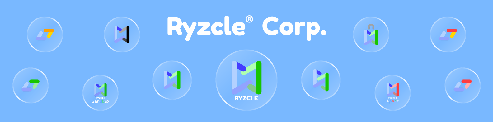

# 

  

<h3 align="center">Software Engineer | High-Performance Web Systems & Clean Architecture</h3>

  

---

### 🚀 About Me

- 🏛️ **Founder & Lead Architect** @ **[Ryzcle® Corp.](https://ryzcle.com/)** — Engineering scalable digital ecosystems and custom web solutions.
- 🎓 **Computer Science Undergrad** & **Google Student Ambassador '26 Alumnus** (Gemini Rising Star Tier).
- 🍎 **Apple Ecosystem Advocate:** Specializing in Swift, SwiftUI, and Human Interface Guidelines (HIG) for native apps.
- 💻 **Full-Stack Developer:** Experienced in architecting robust web applications, API integrations, and self-hosted infrastructure.
- 🛠️ **Featured Work:** Creator of platforms like **Valen Gadget Rent** and interactive digital solutions.
- 🎯 **Current Focus:** Scaling Ryzcle® Corp's product suite, delivering high-precision software services, and exploring advanced UI/UX principles.

---

### ⚙️ Tech Stack & Tools

**Core & Web**  

**Mobile & Apple Ecosystem**  

**Database & Infrastructure**  

---

### 📊 GitHub Analytics

  

---

### 🌐 Let's Connect

  
  
  
  
  

